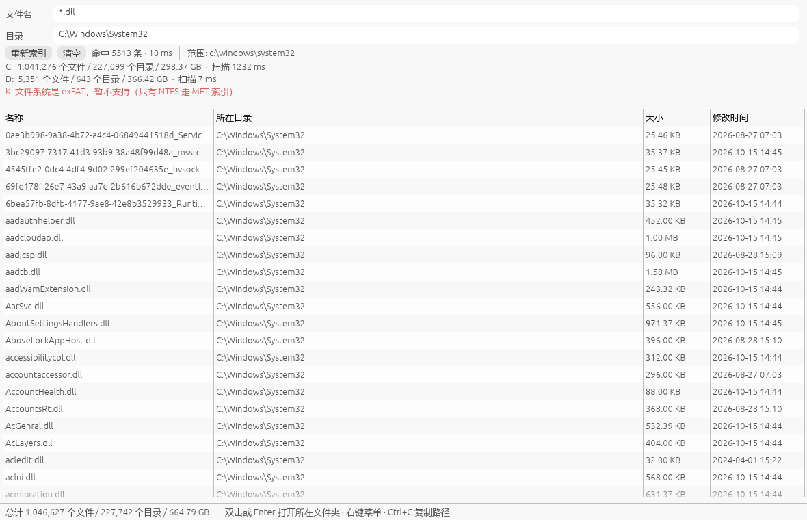

# FastFind

一个类似 [Everything](https://www.voidtools.com/) 的 Windows 文件名搜索小工具：直接读取 NTFS 的
`$MFT`（主文件表）建立内存索引，百万级文件也能在 1~2 秒内建好索引、几毫秒内出结果。

界面全部使用 Windows 原生控件（EDIT / BUTTON / SysListView32 / 进度条 / 状态栏），没有第三方 GUI 框架，
也没有 GPU 依赖（只有几个标签和提示文字是窗口自己在 `WM_PAINT` 里画的）；单个 exe，无运行时依赖。



## 使用

1. 双击 `FastFind.exe`。读取 `$MFT` 需要管理员权限，会弹出 UAC；也可以右键"以管理员身份运行"。
2. 启动后自动索引所有**固定 NTFS 磁盘**，窗口上方会显示每个盘的进度和统计。
3. 在"文件名"里输入通配符，**输入即搜索**（停止输入约 130 ms 后自动执行），按 Enter 可以立即执行。例如：

   | 输入 | 含义 |
   | --- | --- |
   | `*.log` | 所有 .log 文件 |
   | `report_???.docx` | report_ 加 3 个任意字符 |
   | `*kernel32*` | 名字里包含 kernel32 |
   | `*.tar.*` | 组合通配符 |

   只支持 `*`（任意多个字符）和 `?`（一个字符），不区分大小写（中文按字符匹配）。

4. "目录"可以留空（= 全部磁盘），也可以填：

   - `C:\Windows\System32`（带盘符，精确定位到该目录及其子目录）
   - `C:\` 或 `C:`（整个 C 盘）
   - `Windows\System32`（不带盘符，按路径子串匹配，可能跨盘）

   在"目录"框里**双击**会弹出系统的文件夹选择对话框，选完自动填入并搜索。

5. 结果操作：

   - **双击 / Enter**：打开该条目所在的文件夹（即它的父目录）
   - **右键菜单**
     - 复制文件：把真实文件放进剪贴板，可以直接在资源管理器里粘贴
     - 复制文件名：只复制名字，可粘贴到记事本等程序
     - 复制路径：复制该条目所在的**文件夹**路径（双击时打开的就是这个文件夹），
       可以直接粘贴到资源管理器地址栏或"另存为"对话框里
   - **Ctrl+C**：复制选中文件（和右键“复制文件”一样，可直接在资源管理器粘贴）
   - **Esc**：清空两个输入框
   - **重新索引**：文件有增删后手动重建索引

   鼠标在结果列表上是普通箭头，不会变成文本选择的工字形光标。

6. 界面语言跟随 Windows 的显示语言：中文系统显示中文，其他系统显示英文（菜单、按钮、状态栏都是）。
   想强制指定可以用环境变量 `FASTFIND_LANG=zh` 或 `FASTFIND_LANG=en`。

## 性能（本机实测，C: 约 104 万文件 / 22.7 万目录）

| 项目 | 结果 |
| --- | --- |
| 读取 `$MFT`（1.29 GB）并解析 | ~1.33 s |
| 构建索引 | ~0.15 s |
| 常驻内存（索引 + 路径） | ~135 MB |
| `*.dll`（76,302 条，全量返回） | 7 ms 扫描 + 排序，界面显示 ~80 ms |
| `*.exe`（8,946 条） | ~7 ms |
| `*kernel32*`（子串匹配，112 条） | ~34 ms |
| 目录过滤 `*.dll` in `C:\Windows\System32` | 5,513 条，~8 ms |

D 盘 5,351 个文件约 20 ms；exFAT 的 U 盘会提示不支持并跳过。

## 实现要点

- 通过 `\\.\C:` 卷句柄 + `FSCTL_GET_NTFS_VOLUME_DATA` 拿到 MFT 位置、记录大小等几何信息。
- 从 MFT 记录 0 解析 `$MFT` 自己的 `$DATA` runlist（支持碎片化 MFT），按 16 MB 分块顺序读，
  rayon 并行处理每条 1 KB 的 FILE 记录：USA fixup、`$STANDARD_INFORMATION`、`$FILE_NAME`。
- 索引只存"名字 + 父目录记录号"，目录路径按记录号 memo 缓存，全路径按需拼接 —— 这是内存能压到
  ~135 MB 的关键。
- 硬链接（如 WinSxS）的多个名字如果被放进 `$ATTRIBUTE_LIST` 扩展记录，会在扫描结束后按 base
  记录号挂回原条目，因此 `C:\Windows\System32\kernel32.dll` 这类 POSIX 命名空间链接也能搜到。
- 搜索时先用名字匹配（`*.ext` / `prefix*` / `*x*` 会编译成专用的后缀/前缀/子串匹配器）筛掉绝大多数
  条目，再对候选做目录祖先链检查。搜索在独立线程执行，输入变化会合并请求、丢弃过期结果。
- 剪贴板走 Win32：文件用 `CF_HDROP`（`Preferred DropEffect` 设为复制），文本用
  `CF_UNICODETEXT`，所以资源管理器、记事本等任何程序都能粘贴。

## 限制与已知差异

- **只支持本机固定 NTFS 卷**。exFAT / FAT32 / ReFS / 网络盘 / 可移动盘不会索引，界面会给出提示。
- 启动时做一次全量索引，**不监听 USN 日志**；文件增删后需要点"重新索引"。
- 每个盘的"大小合计"是文件逻辑大小之和，含硬链接的重复计数，和资源管理器的"已用空间"不是同一个口径
  （后者还包含簇对齐、MFT 元数据、卷影副本等）。
- 单次结果上限 100,000 条，超出会标记"（已截断）"。
- 不带盘符的目录按路径子串过滤，比如 `Windows\System32` 也会匹配 `D:\backup\Windows\System32`。
- 索引期间界面可交互，但结果要等对应磁盘索引完成后才出现。

## 构建

需要 Rust（MSVC toolchain）和 Visual Studio C++ Build Tools（含 Windows SDK，`build.rs` 会用其中的
`rc.exe` 把图标和版本信息编进 exe）：

```powershell
cargo build --release
# 产物：target\release\fastfind.exe
```

依赖：`windows-sys`（Win32 API）、`rayon`（并行解析）、`memchr`（子串搜索）、`anyhow`；界面没有
任何第三方 GUI 库，全部是 comctl32 / user32 的原生控件。图标只有一份：`assets/fastfind.ico` 由
`app.rc` + `build.rs` 编进 exe，窗口直接使用 exe 里的这份图标资源（`WM_SETICON` + `ICON_BIG/SMALL`），
所以资源管理器、标题栏、任务栏的图标完全一致。`fastfind.manifest` 也是通过 `app.rc` 编进 exe 的，用来启用
Common Controls v6（原生控件的外观）和 PerMonitorV2 DPI 感知。

release 产物约 700 KB，单文件，无运行时依赖。

## 调试

```powershell
# 索引自检：扫描第一个 NTFS 固定盘，把报告写到 %TEMP%\fastfind-selftest.log
fastfind.exe --selftest

# 无头截图（索引完成后写 PNG 并退出），用于 UI 回归
fastfind.exe --screenshot shot.png --pattern "*.dll" --dir "C:\Windows\System32"

# 连标题栏一起截图（把窗口置顶后从屏幕抓取），用来检查窗口图标
fastfind.exe --window-shot window.png

# 剪贴板回归：把文本写进系统剪贴板，2 秒后退出；用记事本或 Get-Clipboard 验证
fastfind.exe --copy-test "hello"
```

运行日志：`%LOCALAPPDATA%\FastFind\fastfind.log`。

## 源码结构

| 文件 | 作用 |
| --- | --- |
| `src/main.rs` | 参数解析、入口（普通启动 / 调试模式） |
| `src/ui.rs` | 原生 Win32 界面：窗口过程、布局、列表虚表、搜索调度、菜单与快捷键 |
| `src/mft.rs` | `$MFT` 读取、FILE 记录/属性/runlist 解析 |
| `src/index.rs` | 内存索引、目录路径 memo、`dir_map`、祖先链判断 |
| `src/search.rs` | 查询解析、目录范围、搜索线程 |
| `src/wildcard.rs` | `*` / `?` 通配符匹配（含专用快速路径与测试） |
| `src/volume.rs` | 卷句柄、NTFS 几何信息、固定磁盘枚举 |
| `src/winutil.rs` | Win32 小工具、剪贴板（`CF_HDROP`）、文件夹选择框、截图、大小/时间/数字格式化 |
| `src/i18n.rs` | 中英文界面（按 Windows 显示语言选择，可用 `FASTFIND_LANG` 覆盖） |
| `src/elevate.rs` | 管理员权限检测与 UAC 重启 |
| `src/selftest.rs` | `--selftest` 报告 |
| `src/png.rs` | 截图用的无依赖 PNG 编码 |
| `app.rc` / `build.rs` | 把 `assets/fastfind.ico`、版本信息和 `fastfind.manifest` 编进 exe |
| `fastfind.manifest` | Common Controls v6、PerMonitorV2 DPI、长路径 |

MIT License.
